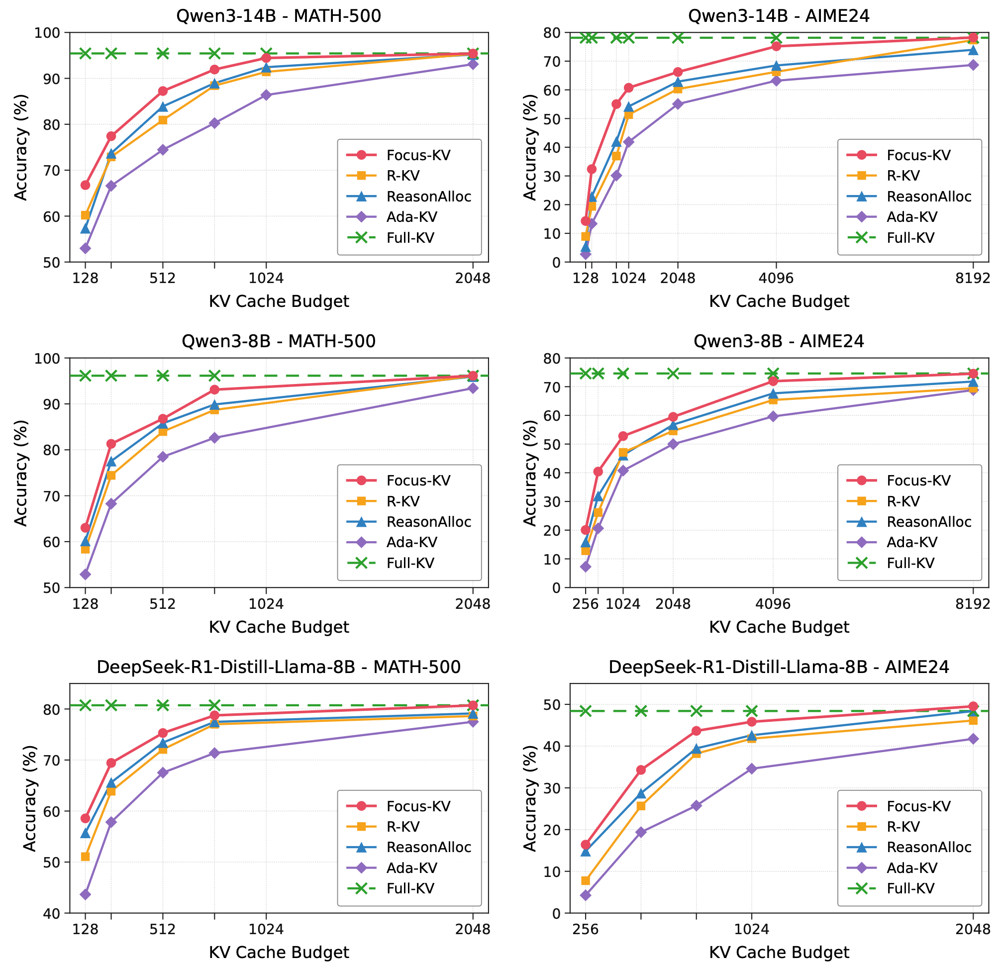
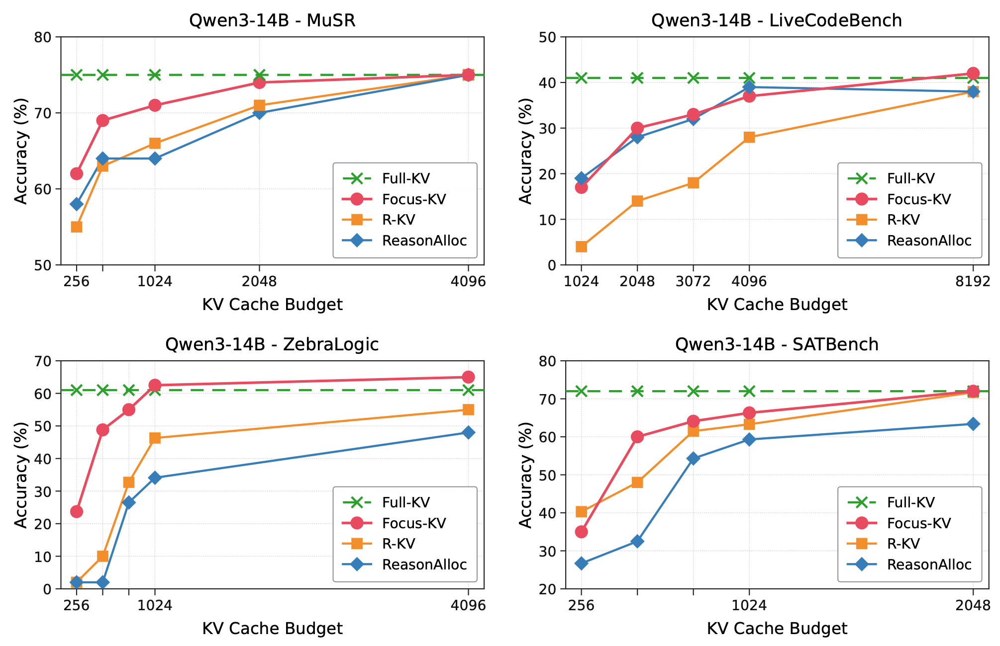

# Focus-KV: Head-wise KV Cache Compression Focus on Reasoning Heads

Code for **Focus-KV**, a static head-wise KV-cache compression method that allocates more cache capacity to attention heads that are important for reasoning. Head importance is estimated offline on a reasoning probe set, and the resulting budgets remain fixed during decoding.

## Method

Motivated by the observation that reasoning ability is concentrated in a sparse subset of attention heads, we propose **Focus-KV**, a static head-wise KV-cache compression algorithm. Focus-KV improves the model's reasoning ability by assigning non-uniform cache budgets across KV heads. Using the importance signal obtained from the probe set, Focus-KV uses a balanced allocation rule with an explicit budget floor and budget cap, ensuring that reasoning-critical heads receive more cache capacity while other heads still retain sufficient budget to keep their basic functionality. By shifting more cache budget toward reasoning-critical heads, Focus-KV improves reasoning performance under the same overall memory constraint.

**Notation.** We write $`S`$ for the probe set, $`\bar{B}`$ for the average per-head KV budget, $`w`$ for the local-window size, $`\rho\in(0,1)`$ for the uniform-floor ratio, $`\kappa>1`$ for the max-budget cap multiplier, and $`\lambda`$ for the attention/similarity mixing weight. We use $`L`$ for the number of decoder layers, $`H_q`$ for query heads per layer, and $`H_{kv}`$ for KV heads per layer, with GQA grouping $`G=H_q/H_{kv}`$.

Focus-KV consists of four steps:

1. [Construct a high-quality probe set.](#probe-set-construction)
2. [Estimate the contribution of each query head to reasoning tasks.](#importance-signal-via-causal-ablation)
3. [Convert head importance into a balanced KV-head budget allocation.](#budget-allocation)
4. [Compress the KV cache using the allocated head-wise budgets, computed before inference and fixed during decoding.](#kv-cache-compression)

### Probe Set Construction

We construct the probe set $`S`$ from OpenR1-Math-220K (Hugging Face, 2025). First, we apply data cleaning to retain usable samples. Then, for each remaining sample, we compute two metrics: (a) the average length of the `<think>...</think>` reasoning trace and (b) the per-sample difficulty, defined as

$$
1-\frac{\text{correctness count}}{n_{\mathrm{gen}}}.
$$

Following recent long-CoT data-selection practice (Yang et al., 2025b), samples are ranked in descending order by reasoning trace length ($`r_\ell`$) and difficulty ($`r_d`$); the combined rank

$$
r=0.75\,r_\ell+0.25\,r_d
$$

selects the top 100 samples: long, hard reasoning problems that can effectively reflect the model's reasoning ability.

### Importance Signal via Causal Ablation

Given the probe set, we estimate the importance of each query head by measuring how much the model's next-token prediction loss changes when that head is disabled. First, we perform a forward-pass evaluation on the probe set and compute the next-token cross-entropy loss, denoted as $`\mathcal{L}_{\mathrm{baseline}}`$, which serves as the baseline measure of the model's basic reasoning performance. Then, for each query head at position $`(k,h)`$, we scale the output of that query head by $`\varepsilon=10^{-9}`$ to disable it and compute the next-token cross-entropy loss again, denoted as $`\mathcal{L}_{\mathrm{ablation}}(k,h)`$. This query head's importance is defined as

$$
I(k,h)\triangleq\mathcal{L}_{\mathrm{ablation}}(k,h)-\mathcal{L}_{\mathrm{baseline}}.
$$

This score has a direct causal interpretation: if disabling a head causes a large increase in next-token cross-entropy, then the head contributes substantially to the model's reasoning trajectory; if the loss change is close to zero, then this head is much less important for the reasoning task.

### Budget Allocation

For models using GQA, each KV head corresponds to $`G`$ query heads. We take the maximum importance score among these query heads as the importance of the KV head, denoted as $`I_{kv}(k,p)`$, where $`p`$ denotes the position of the KV head in layer $`k`$:

$$
I_{kv}(k,p)\triangleq\max_{h=pG,\ldots,(p+1)G-1} I(k,h).
$$

Then, for all KV heads, we clip negative importance scores to zero and normalize them to satisfy $`\tilde{I}_{kv}(k,p)\geq 0`$ and $`\sum_{k,p}\tilde{I}_{kv}(k,p)=1`$:

$$
\tilde{I}_{kv}(k,p)=\frac{\max(I_{kv}(k,p),0)}{\sum_{k',p'}\max(I_{kv}(k',p'),0)}.
$$

Let $`\bar{B}\triangleq B_{\mathrm{total}}/(LH_{kv})`$. The budget assigned to each KV head is defined as

$$
B(k,p)=w+\underbrace{\rho(\bar{B}-w)}_{\text{uniform floor }U}+r(k,p),
\tag{1}
$$

where $`r(k,p)\geq 0`$ denotes the extra reward budget for reasoning contribution. To allocate this extra budget, define

$$
P\triangleq B_{\mathrm{total}}-LH_{kv}(w+U),\qquad M\triangleq\kappa\bar{B}-w-U,
$$

where $`P`$ is the total extra-budget pool and $`M`$ is the cap on the extra reward budget. If no head reaches the cap, the allocation reduces to

$$
r(k,p)=P\tilde{I}_{kv}(k,p).
$$

If some heads reach the cap, their extra budget is fixed to $`r(k,p)=M`$, equivalently $`B(k,p)=\kappa\bar{B}`$. We then redistribute the remaining extra budget among the uncapped heads. Let $`\mathcal{A}`$ be the current set of uncapped heads and let $`P_{\mathcal{A}}`$ be the remaining extra-budget pool. In each redistribution step, we assign

$$
\hat{r}(k,p)=P_{\mathcal{A}}\frac{\tilde{I}_{kv}(k,p)}{\sum_{(k',p')\in\mathcal{A}}\tilde{I}_{kv}(k',p')},\qquad(k,p)\in\mathcal{A}.
$$

If $`\mathcal{F}_{\mathrm{new}}`$ denotes the heads capped in the current step, we set $`r(k,p)=M`$ for $`(k,p)\in\mathcal{F}_{\mathrm{new}}`$ and return the exceeded budget to the pool:

$$
E=\sum_{(k,p)\in\mathcal{F}_{\mathrm{new}}}\left(\hat{r}(k,p)-M\right).
$$

The active set and remaining pool are then updated as

$$
\mathcal{A}\leftarrow\mathcal{A}\setminus\mathcal{F}_{\mathrm{new}},\qquad P_{\mathcal{A}}\leftarrow\sum_{(k,p)\in\mathcal{A}}\hat{r}(k,p)+E.
$$

We repeat this cap-and-redistribute step until every uncapped head satisfies $`r(k,p)\leq M`$, which ensures

$$
\sum_{k,p}B(k,p)=B_{\mathrm{total}}.
\tag{2}
$$

### KV Cache Compression

At inference time, Focus-KV reuses the R-KV scoring step (Cai et al., 2026) to evict tokens. For each compression event, each KV head $`p`$, and each cached position $`t`$, we score

$$
s_p(t)=\lambda\cdot\mathrm{maxpool}_k\left(\mathrm{softmax}\left(QK^\top/\sqrt{d}\right)_p\right)[t]-(1-\lambda)\cdot\mathrm{sim}_p(t),
\tag{3}
$$

where $`\mathrm{sim}_p(t)`$ is the row-mean cosine similarity of position $`t`$'s key to the rest of the cache. We keep the top $`B(k,p)-w`$ positions and the last $`w`$ positions.

## Experiment Results

### Mathematical Reasoning

**Figure 4.** Focus-KV compared with R-KV, ReasonAlloc, Ada-KV, and Full-KV on MATH-500 and AIME24. Results are reported as pass@1 based on 32 generated responses per question. Focus-KV improves accuracy over R-KV across the evaluated models, with particularly large gains under constrained KV-cache budgets.

### Cross-Domain Reasoning

**Figure 8.** Accuracy (%) of Focus-KV, R-KV, ReasonAlloc, and Full-KV on MuSR, LiveCodeBench, ZebraLogic, and SATBench using Qwen3-14B. These results evaluate reasoning performance beyond the mathematical domain used for head-importance profiling.

## Repository Structure

| Path | Contents |
| --- | --- |
| [`compression/focuskv.py`](compression/focuskv.py) | Importance loading, head-wise budget allocation, and variable-length per-head KV-cache compression. |
| [`compression/focuskv_v2.py`](compression/focuskv_v2.py) | Rectangular-cache implementation with per-head padding for batched attention. |
| [`modeling.py`](modeling.py) | Attention and model-forward integration. |
| [`monkeypatch.py`](monkeypatch.py) | Entry points for patching Llama, Qwen2, and Qwen3. |
| [`utils.py`](utils.py) | Attention-score, similarity, and supporting utilities. |
| [`probeset/find_reasoning_heads_multigpu.py`](probeset/find_reasoning_heads_multigpu.py) | Multi-GPU query-head ablation and importance profiling. |
| [`probeset/probeset.jsonl`](probeset/probeset.jsonl) | Probe data containing 300 records; the [probe-set construction](#probe-set-construction) procedure selects 100 samples for profiling. |
| [`head_importance/`](head_importance/) | Precomputed query-head importance profiles for Qwen3-8B, Qwen3-14B, and DeepSeek-R1-Distill-Llama-8B. |

## References

- Hugging Face (2025). [*Open R1: A Fully Open Reproduction of DeepSeek-R1.*](https://github.com/huggingface/open-r1)
- Cehao Yang et al. (2025b). [*Select2Reason: Efficient Instruction-Tuning Data Selection for Long-CoT Reasoning.*](https://arxiv.org/abs/2505.17266)
- Zefan Cai et al. (2026). [*R-KV: Redundancy-Aware KV Cache Compression for Reasoning Models.*](https://arxiv.org/abs/2505.24133)
